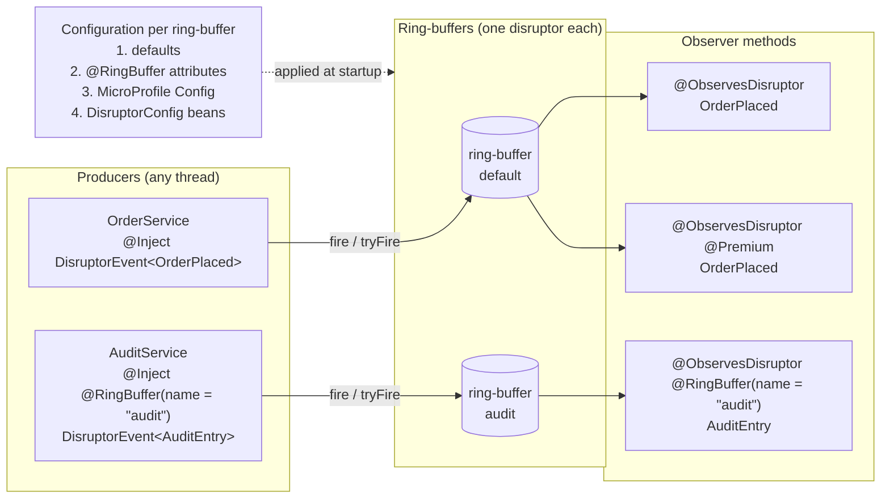
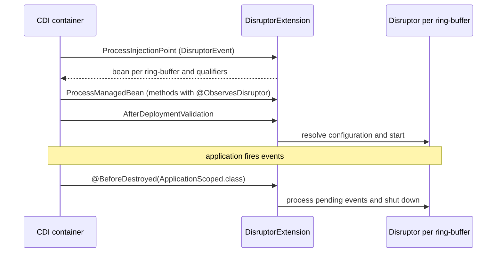
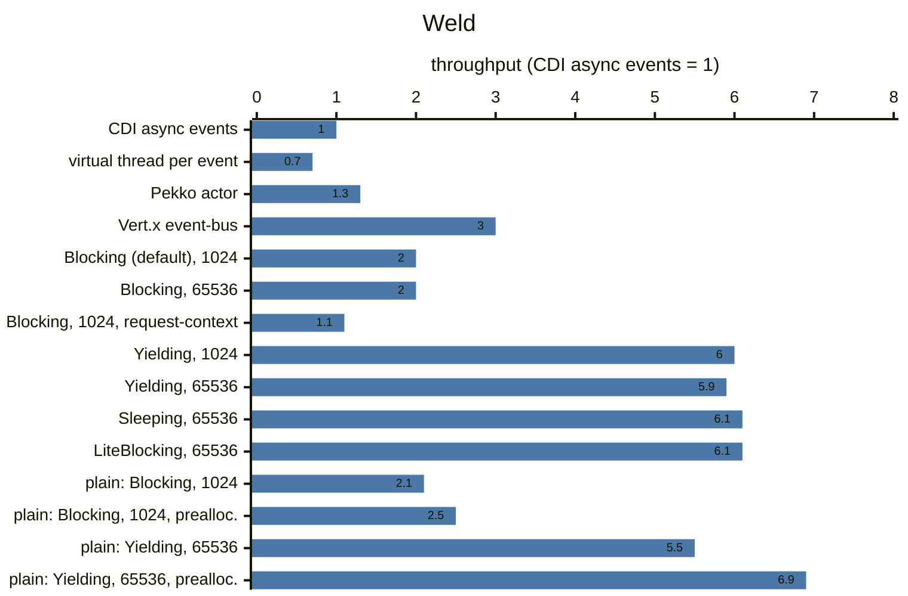
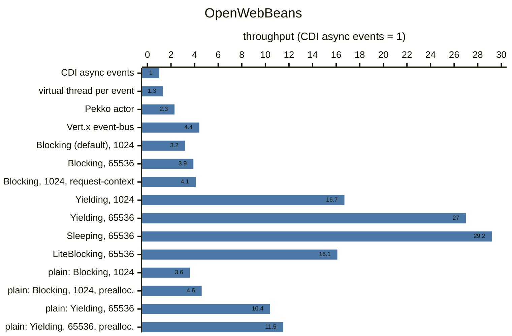

<!--
  Copyright 2026 os890

  Licensed under the Apache License, Version 2.0 (the "License");
  you may not use this file except in compliance with the License.
  You may obtain a copy of the License at

      http://www.apache.org/licenses/LICENSE-2.0

  Unless required by applicable law or agreed to in writing, software
  distributed under the License is distributed on an "AS IS" BASIS,
  WITHOUT WARRANTIES OR CONDITIONS OF ANY KIND, either express or implied.
  See the License for the specific language governing permissions and
  limitations under the License.
-->
# cdi-disruptor-addon

Portable CDI extension (CDI 4 / Jakarta EE 10+) which dispatches events via the
[LMAX Disruptor](https://github.com/LMAX-Exchange/disruptor) - used like CDI events,
but asynchronous, with allocation-free dispatching and bounded (named) ring-buffers.

## Usage

The add-on isn't published to Maven Central yet - install it into the local Maven repository first:

```
git clone https://github.com/os890/cdi-disruptor-addon.git
cd cdi-disruptor-addon
mvn install
```

Add the dependency for your CDI container - the extension gets activated automatically:

```xml
<!-- CDI Full (portable extension) - e.g. Weld, OpenWebBeans, Jakarta EE servers -->
<dependency>
    <groupId>org.os890.cdi</groupId>
    <artifactId>cdi-disruptor-addon</artifactId>
    <version>1.0.0-SNAPSHOT</version>
</dependency>

<!-- CDI Lite (build-compatible extension) - e.g. Quarkus -->
<dependency>
    <groupId>org.os890.cdi</groupId>
    <artifactId>cdi-disruptor-addon-lite</artifactId>
    <version>1.0.0-SNAPSHOT</version>
</dependency>
```

The API and the usage are the same for both.

Fire events:

```java
@ApplicationScoped
public class OrderService {
    @Inject
    private DisruptorEvent<OrderPlaced> orderPlacedEvent;

    @Inject
    @Premium
    private DisruptorEvent<OrderPlaced> premiumOrderPlacedEvent;

    public void placeOrder(OrderPlaced order) {
        orderPlacedEvent.fire(order); // returns immediately - waits only if the ring-buffer is full
    }

    public boolean placePremiumOrder(OrderPlaced order) {
        return premiumOrderPlacedEvent.tryFire(order); // never waits - false if the ring-buffer is full
    }
}
```

Observe events:

```java
@ApplicationScoped
public class OrderObserver {
    // qualifiers and additional injected parameters work like for CDI observers
    void onPremiumOrder(@ObservesDisruptor @Premium OrderPlaced order, AuditService auditService) {
        // invoked on a disruptor thread
    }

    // opt-in: new request-context per event (needed for @RequestScoped beans, costs throughput)
    void onOrder(@ObservesDisruptor(requestContext = true) OrderPlaced order, RequestScopedAudit audit) {
    }
}
```

Requirements: Java 17+, Disruptor 4 (`com.lmax:disruptor`, transitive dependency), MicroProfile Config is optional and

* `cdi-disruptor-addon`: a CDI 4 container with support for portable extensions (CDI Full - e.g. Weld or
  OpenWebBeans)
* `cdi-disruptor-addon-lite`: a CDI 4.1 container with support for build-compatible extensions (CDI Lite -
  e.g. Quarkus 3), see [CDI Lite](#cdi-lite-eg-quarkus)

## Modules

| module                     | content                                                                          |
|----------------------------|----------------------------------------------------------------------------------|
| `cdi-disruptor-addon-core` | API and container-independent runtime (transitive dependency of both extensions) |
| `cdi-disruptor-addon`      | portable extension (CDI Full)                                                     |
| `cdi-disruptor-addon-lite` | build-compatible extension (CDI Lite) - tested with Quarkus                      |

## How it works



* `fire` publishes the event into the ring-buffer of its `DisruptorEvent` and returns -
  the observer methods which match the event-type and qualifiers are resolved once per event-type
* every observer method of a ring-buffer has its own event-handler thread, which skips events it doesn't observe
* a ring-buffer slot gets reused once all observer methods of the ring-buffer processed it
* every observer method releases its reference to the event after the notification -
  processed events don't stay referenced by the ring-buffer and no additional thread is needed for it

Lifecycle of the extension:



## Semantics

* every observer method is an own event-handler (thread) of the disruptor:
  different observer methods run in parallel, a single observer method receives events in publishing order
* an observer gets notified if the runtime type of the event is assignable to the observed (raw) type
  and its qualifiers are a subset of the event qualifiers (`@Default` on the observer = only unqualified events)
* the request-context is only active if requested via `@ObservesDisruptor(requestContext = true)` -
  activating it per event is expensive (with Weld it's as slow as CDI async events, see [Performance](#performance))
* `fire` doesn't allocate and doesn't block unless the ring-buffer is full (backpressure) - `tryFire` never blocks,
  with [`@CircuitBreaker`](#circuit-breaker) `fire` rejects events instead of blocking
* every named ring-buffer is a bulkhead: a slow observer can only fill its own ring-buffer
  (but it slows down all observers of the same ring-buffer, once the ring-buffer is full)
* observers of `@Dependent` beans get a new instance per event, which gets destroyed afterwards
* pending events get processed before the application-context gets destroyed
  (max. the shutdown-timeout of the ring-buffer, see `RingBufferSettings#shutdownTimeout`)
* exceptions of observer methods get logged and don't affect other observers

## Ring-buffers

By default all events use the ring-buffer `default` (`@RingBuffer(size = 4096)` without a name configures it).
`@RingBuffer(name = "...")` selects a named ring-buffer with an own configuration and own threads.
There is exactly one ring-buffer per name - all injection points and observers with the same name share it.

```java
@Inject
@RingBuffer(name = "audit", size = 4096, waitStrategy = YieldingWaitStrategy.class)
private DisruptorEvent<AuditEntry> auditEvent;

void onAuditEntry(@ObservesDisruptor @RingBuffer(name = "audit") AuditEntry entry) {
    // only receives events of the ring-buffer "audit"
}
```

The configuration of every ring-buffer gets resolved once during the bootstrapping
(later entries override former ones):

1. defaults: size 1024, `BlockingWaitStrategy`, `ProducerType.MULTI`, 10s shutdown-timeout, daemon threads,
   circuit-breaker: failure-threshold 5, delay 10s, max. wait-time 0
2. `@Nonbinding` attributes of `@RingBuffer` (`size`, `waitStrategy`) -
   all usages with the same name have to specify the same values (or none)
3. MicroProfile Config (optional, used if available):
   ```properties
   cdi.disruptor.audit.size=8192
   cdi.disruptor.audit.wait-strategy=BusySpinWaitStrategy
   cdi.disruptor.audit.producer-type=SINGLE
   cdi.disruptor.audit.shutdown-timeout-ms=5000
   cdi.disruptor.audit.circuit-breaker.failure-threshold=10
   cdi.disruptor.audit.circuit-breaker.delay-ms=30000
   cdi.disruptor.audit.circuit-breaker.max-wait-ms=5
   ```
4. beans implementing `DisruptorConfig` (e.g. for custom thread-factories or wait-strategies with parameters):
   ```java
   @ApplicationScoped
   public class AuditRingBufferConfig implements DisruptorConfig {
       @Override
       public void configure(RingBufferSettings settings) {
           if ("audit".equals(settings.name())) {
               settings.waitStrategy(new TimeoutBlockingWaitStrategy(1, TimeUnit.MILLISECONDS));
           }
       }
   }
   ```

## Circuit-breaker

`@CircuitBreaker` is a marker annotation for two use-cases - its settings are part of the configuration of the
ring-buffer (failure-threshold, delay and max. wait-time - see above):

**Protect the producer** (`DisruptorEvent` injection points):
the disruptor protects the observers from overload, because they process the events of a bounded ring-buffer at
their own pace - if they can't keep up, the ring-buffer gets full and `fire` waits for free slots (backpressure).
With `@CircuitBreaker` the producer doesn't get blocked:

```java
@Inject
@CircuitBreaker
private DisruptorEvent<OrderPlaced> orderPlacedEvent;

try {
    orderPlacedEvent.fire(order);
} catch (EventRejectedException e) {
    // the ring-buffer is full (no free slot within the max. wait-time) or the circuit-breaker is open
}
```

* closed: an event gets rejected, if there is no free slot within the max. wait-time
  (`fire` throws an `EventRejectedException`, `tryFire` returns false)
* open: after the failure-threshold of consecutive rejections, all events get rejected immediately for the delay -
  the observers get time to process the pending events
* half-open: after the delay one event gets published as trial - the circuit-breaker gets closed, if it was accepted
* there is one circuit-breaker per ring-buffer for all its injection points with `@CircuitBreaker` -
  injection points without it aren't affected

**Protect against failing observers** (observer methods):

```java
@CircuitBreaker
void onOrderPlaced(@ObservesDisruptor OrderPlaced event, RemoteService remoteService) {
    remoteService.send(event); // might fail
}
```

* closed: the observer method gets notified
* open: after the failure-threshold of consecutive exceptions, the observer method doesn't get notified
  for the delay (the events get skipped, counted and logged)
* half-open: after the delay the next event gets passed to the observer method as trial -
  the circuit-breaker gets closed, if it doesn't fail
* every observer method has its own circuit-breaker - other observer methods aren't affected

## Performance

Duration from firing the first event until the observer processed the last one, relative to CDI async events
(`Event#fireAsync` with `@ObservesAsync` = 100%, lower is faster):

| variant                                                         | ring-buffer size | Weld | OpenWebBeans |
|-----------------------------------------------------------------|-----------------:|-----:|-------------:|
| CDI `fireAsync` / `@ObservesAsync`                              |                - | 100% |         100% |
| virtual thread per event (without CDI)                          |                - | 145% |          79% |
| Apache Pekko actor (without CDI)                                |                - |  79% |          44% |
| Eclipse Vert.x event-bus (without CDI)                          |                - |  33% |          23% |
| `DisruptorEvent`, default config (`BlockingWaitStrategy`)       |             1024 |  51% |          31% |
| `DisruptorEvent`, default config (`BlockingWaitStrategy`)       |            65536 |  50% |          26% |
| `DisruptorEvent`, `@ObservesDisruptor(requestContext = true)`   |             1024 |  90% |          24% |
| `DisruptorEvent`, `YieldingWaitStrategy`                        |             1024 |  17% |           6% |
| `DisruptorEvent`, `YieldingWaitStrategy`                        |            65536 |  17% |           4% |
| `DisruptorEvent`, `SleepingWaitStrategy`                        |            65536 |  16% |           3% |
| `DisruptorEvent`, `LiteBlockingWaitStrategy`                    |            65536 |  17% |           6% |
| plain Disruptor (without CDI), `BlockingWaitStrategy`           |             1024 |  48% |          28% |
| plain Disruptor (without CDI), `BlockingWaitStrategy`, preallocated |         1024 |  40% |          22% |
| plain Disruptor (without CDI), `YieldingWaitStrategy`           |            65536 |  18% |          10% |
| plain Disruptor (without CDI), `YieldingWaitStrategy`, preallocated |        65536 |  15% |           9% |

* virtual thread per event: the client code dispatches every event directly to the consumer via a new virtual thread
* Apache Pekko actor: one actor (default dispatcher and mailbox) which receives the events via `tell` -
  this variant is only part of the branch [`pekko-benchmark`](https://github.com/os890/cdi-disruptor-addon/tree/pekko-benchmark),
  because `main` is limited to CDI
* Eclipse Vert.x event-bus: one verticle with a local event-bus consumer (event-loop thread) which receives the
  events via `EventBus#send` (passed by reference, without back-pressure) - this variant is only part of the branch
  [`vertx-benchmark`](https://github.com/os890/cdi-disruptor-addon/tree/vertx-benchmark)
* plain Disruptor: the Disruptor used directly, without CDI - the slots reference the fired event objects
  (like this add-on) or the event data gets copied into the preallocated slots (idiomatic zero-allocation usage)
* the variants without CDI don't depend on the CDI container - their percentages only differ between the columns,
  because the baseline (CDI async events) differs

The same results as throughput relative to CDI async events (CDI async events = 1, higher is better):





**This isn't a representative measurement - it's just an orientation of what to expect.**
The numbers depend on the hardware, JVM, CDI container, the observer and the configuration.
Measured with 2M events, one producer thread and one observer - every variant in its own JVM
(median of 5 rounds after 2 warmup rounds, median of 4-6 JVM runs) with Weld 5.1 and OpenWebBeans 4.0.
The results of the fastest variants vary considerably between the runs.
A larger ring-buffer only helps if the observer can keep up with the producer (it absorbs bursts,
so the producer doesn't have to wait for free slots) - it doesn't speed up a slow observer,
but it costs memory (the slots are preallocated) and allows more pending events.
CDI async events use an unbounded queue and a thread-pool (no ordering), whereas every observer method of a
ring-buffer has its own thread and receives the events in order.
Busy-spin, yielding and sleeping wait-strategies keep the observer threads busy while waiting for events
(measured without events: ~100% of a core per observer method with `YieldingWaitStrategy`, ~40% with
`SleepingWaitStrategy`, ~0% with the default `BlockingWaitStrategy`) - use them only for ring-buffers which need it.

Run it via
`mvn test -pl cdi-disruptor-addon -am -Dtest=AsyncCdiComparisonTest -Dperf=true -Dsurefire.failIfNoSpecifiedTests=false`
(add `-Powb` for OpenWebBeans).

## CDI Lite (e.g. Quarkus)

`cdi-disruptor-addon-lite` processes everything during the build (build-compatible extension):

* the qualifiers of `DisruptorEvent` injection points get replaced by an internal qualifier and the beans for
  them get added as synthetic beans
* observer methods get invoked via CDI 4.1 invokers (instance- and argument-lookup by the container -
  no reflection)
* the ring-buffers get started by the `Startup` event and stopped (incl. pending events) by the `Shutdown` event
* `@ObservesDisruptor(requestContext = true)` adds `@ActivateRequestContext` to the observer method
* configuration via `@RingBuffer`, MicroProfile Config (e.g. `application.properties` of Quarkus) and
  `DisruptorConfig` beans works like with the portable extension

Additional restrictions:

* `requestContext = true` isn't supported for static observer methods (interceptors don't apply to them)
* private observer methods and arrays as event types aren't supported
* invalid definitions get reported as build errors
* native images aren't tested yet (observed types and wait-strategies get loaded by class-name)

## Restrictions

* `DisruptorEvent` is supported for injection points processed by the container (fields, constructors,
  initializers, producers) and as additional parameter of `@ObservesDisruptor` methods -
  not via programmatic lookup (`Instance<DisruptorEvent<...>>`)
* `fire` within an observer method can dead-lock if the ring-buffer is full - use `tryFire` there
  or `@CircuitBreaker` at the `DisruptorEvent` parameter
* ring-buffers are created during the bootstrapping - selecting a ring-buffer at runtime
  (`select(RingBuffer.Literal.of("x"))`) only reaches observers if the name is used by an observer,
  the configuration attributes of `@RingBuffer` are only evaluated at injection points and observer methods
* events are matched against the raw type of the observed type (e.g. `List<String>` observes all lists)
* private observer methods aren't supported for normal-scoped beans

## Build

```
mvn verify          # portable extension tested with Weld (with and without MicroProfile Config),
                    # build-compatible extension tested with Quarkus
mvn verify -Powb    # portable extension tested with OpenWebBeans (with and without MicroProfile Config)

# manual performance checks of the portable extension
mvn test -pl cdi-disruptor-addon -am -Dtest=ThroughputTest -Dperf=true -Dsurefire.failIfNoSpecifiedTests=false
mvn test -pl cdi-disruptor-addon -am -Dtest=AsyncCdiComparisonTest -Dperf=true -Dsurefire.failIfNoSpecifiedTests=false
```

Apache RAT (license headers of all modules) and Checkstyle (`src/build/checkstyle.xml`) run in the `validate` phase.

## License

[Apache License, Version 2.0](LICENSE)

LMAX is a trademark of its respective owner. This project is an independent integration of the
Apache-2.0 licensed [LMAX Disruptor](https://github.com/LMAX-Exchange/disruptor) and isn't affiliated with,
sponsored or endorsed by LMAX.
